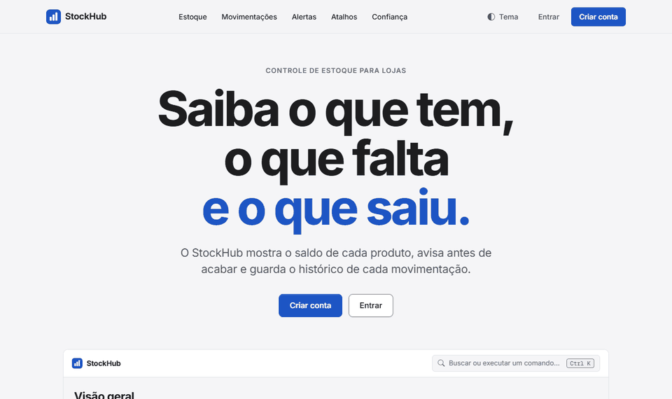
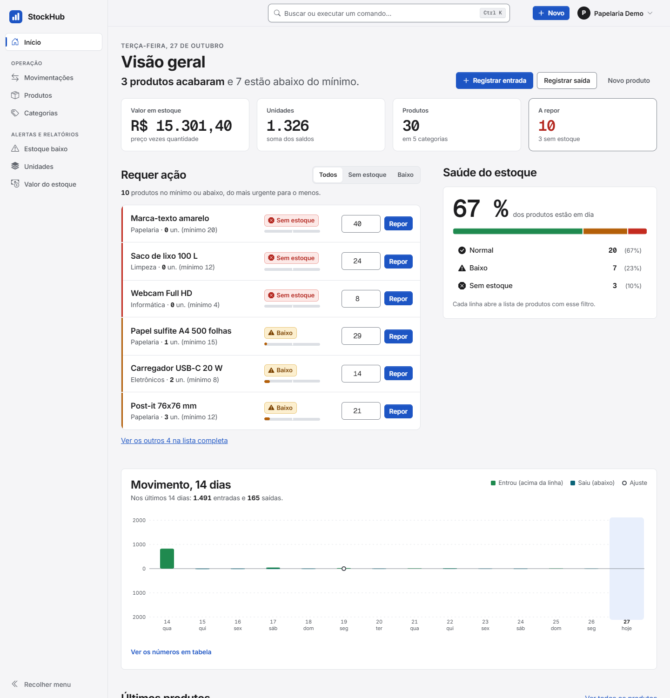
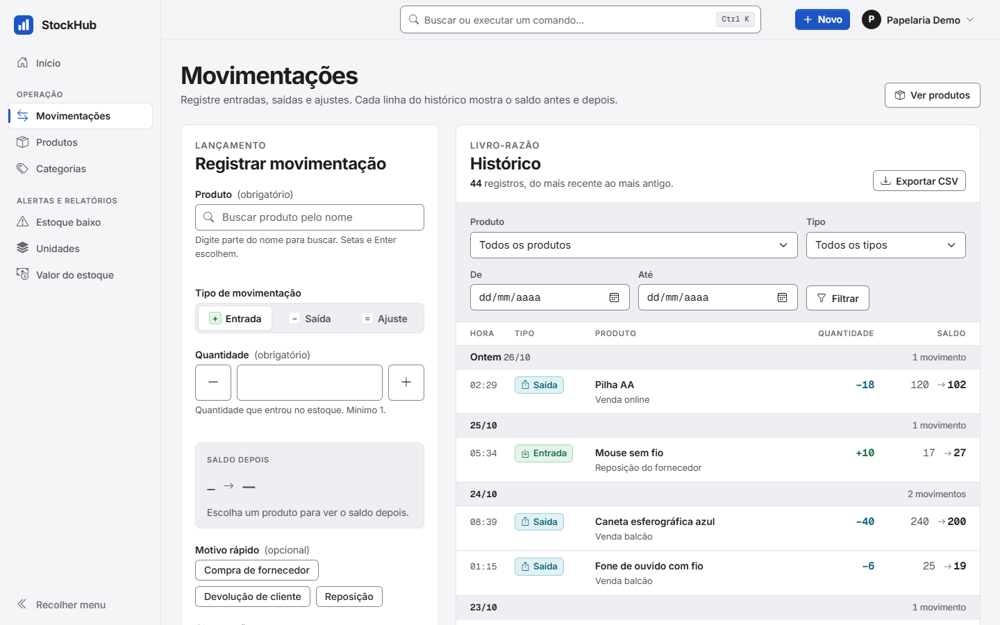
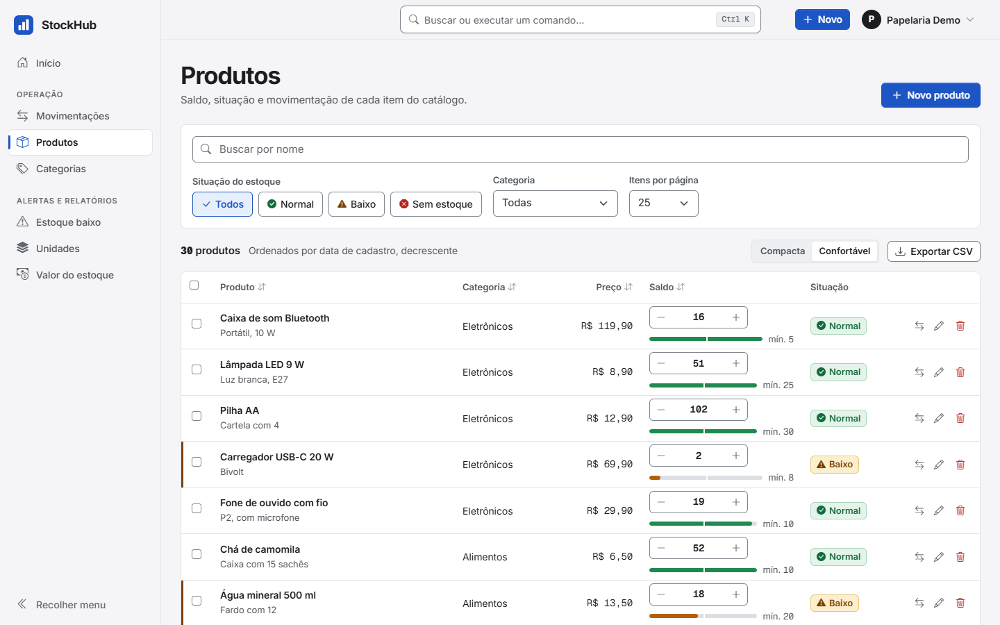
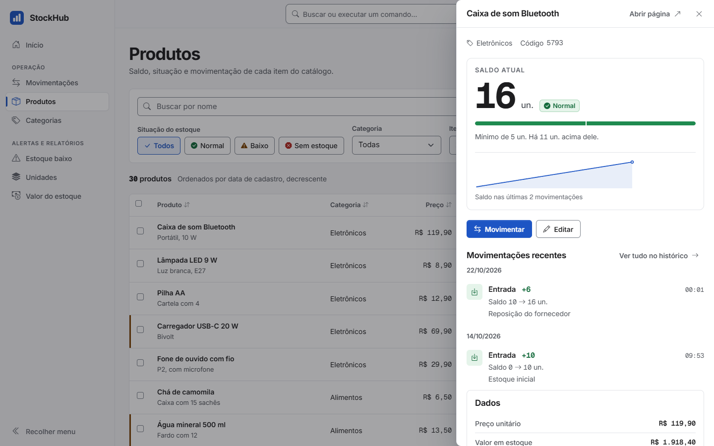
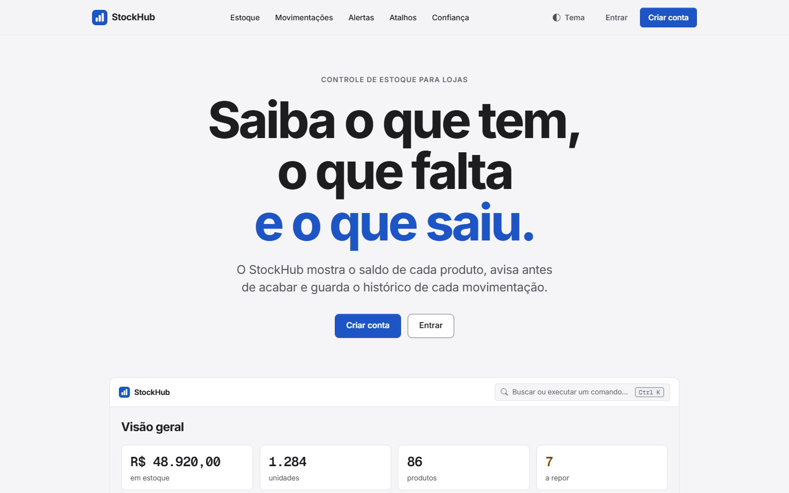
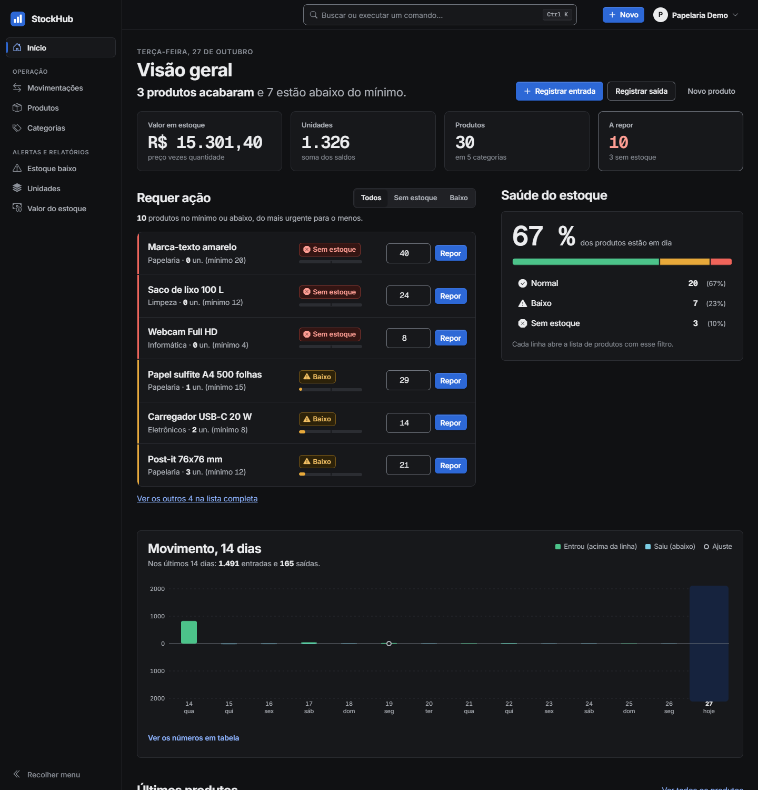
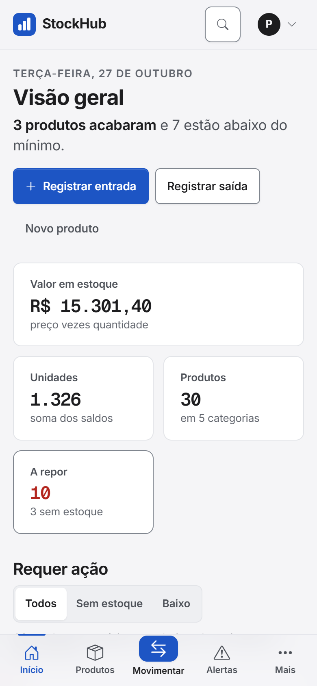
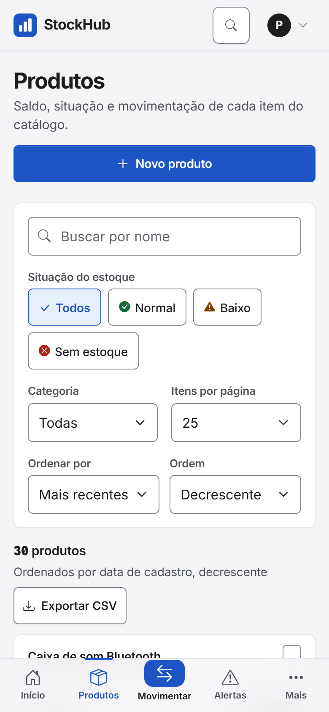

<h1 align="center">StockHub</h1>

<p align="center">
  Sistema web de gestão de estoque com histórico imutável de movimentações,<br>
  alertas de reposição e uma interface pensada para o dia a dia de uma loja.
</p>

<p align="center">
  
  
  
  
  
</p>

<p align="center">
  
</p>

## Sumário

- [Sobre](#sobre)
- [Telas](#telas)
- [Funcionalidades](#funcionalidades)
- [Regras que o sistema garante](#regras-que-o-sistema-garante)
- [Tecnologias](#tecnologias)
- [Arquitetura](#arquitetura)
- [Como rodar](#como-rodar)
- [Testes](#testes)
- [Segurança](#segurança)
- [Documentação](#documentação)
- [Licença](#licença)
- [Autor](#autor)

## Sobre

O StockHub controla o estoque de lojas. Cada conta é uma loja, com seus próprios produtos, categorias e movimentações, e uma loja nunca enxerga os dados de outra.

A ideia central é que **o saldo de um produto só muda por uma movimentação** (entrada, saída ou ajuste). Cada movimentação guarda o saldo de antes e o de depois e não pode ser editada nem apagada, então o histórico serve como trilha de auditoria: dá para saber quanto havia, quanto saiu, quando e por quê.

Projeto acadêmico do curso de Sistemas para Internet da Universidade Federal de Santa Maria (UFSM).

## Telas

<table>
  <tr>
    <td width="50%"><br><sub><b>Visão geral:</b> indicadores, produtos que pedem reposição, saúde do estoque e movimentos dos últimos 14 dias.</sub></td>
    <td width="50%"><br><sub><b>Movimentações:</b> console de lançamento e livro-razão filtrável, com saldo antes e depois.</sub></td>
  </tr>
  <tr>
    <td><br><sub><b>Produtos:</b> busca ao digitar, filtros por situação e categoria, ajuste rápido de saldo e exportação em CSV.</sub></td>
    <td><br><sub><b>Detalhe sem sair da lista:</b> saldo, tendência e últimas movimentações em um painel lateral.</sub></td>
  </tr>
  <tr>
    <td><br><sub><b>Página inicial pública:</b> apresentação em rolagem, com as cenas surgindo conforme você desce.</sub></td>
    <td><br><sub><b>Tema escuro:</b> claro, escuro ou o do sistema.</sub></td>
  </tr>
</table>

<p align="center">
  
  &nbsp;&nbsp;
  
  <br><sub>Responsivo: no celular a navegação vai para a barra inferior.</sub>
</p>

## Funcionalidades

**Estoque**
- Produtos com categoria, preço, saldo e estoque mínimo; cada produto é classificado como *normal*, *baixo* ou *sem estoque*.
- Ajuste rápido de saldo direto na lista, com opção de desfazer.
- Busca ao digitar, filtros, ordenação e painel de detalhe.
- Categorias organizadas por loja; uma categoria em uso não pode ser excluída.

**Movimentações**
- Entrada, saída e ajuste, com observação e motivos rápidos.
- Livro-razão com filtros por produto, tipo e período.
- Produtos com histórico são inativados em vez de apagados, preservando a trilha.

**Gestão**
- Painel com valor em estoque, unidades, produtos a repor e gráfico dos últimos 14 dias (com tabela equivalente para leitores de tela).
- Relatórios de estoque baixo, unidades e valor do estoque.
- Exportação em CSV de produtos (todos, filtrados ou só os marcados) e do histórico de movimentações.

**Experiência**
- Paleta de comandos (`Ctrl+K`) para buscar produtos e ir a qualquer tela.
- Atalhos de teclado (`?` abre a lista) e navegação por teclado nas listas.
- Tema claro, escuro ou do sistema; animação ao trocar de página; respeita a preferência de menos movimento.
- Acessível: foco visível, rótulos em todos os campos e contraste verificado.

## Regras que o sistema garante

- O saldo nunca fica negativo, e duas pessoas movimentando o mesmo produto ao mesmo tempo não corrompem a contagem (bloqueio pessimista no banco).
- O saldo só muda por movimentação, e a movimentação é imutável.
- Cada loja acessa apenas os próprios dados, inclusive nos arquivos CSV.
- O estoque inicial de um produto novo é registrado como uma entrada, para o histórico fechar com o saldo.

O catálogo completo (RN-01 a RN-14) está em [docs/regras-negocio.md](docs/regras-negocio.md).

## Tecnologias

| Camada | Tecnologias |
| :--- | :--- |
| Backend | Java 17, Spring Boot 4.1, Spring MVC, Spring Security, Spring Data JPA (Hibernate), Bean Validation |
| Frontend | JSP e JSTL, Bootstrap 5, JavaScript e CSS próprios, sem etapa de build e sem CDN |
| Banco | PostgreSQL 14+ com migrations Flyway |
| Qualidade | JUnit 5, Mockito, Spring Security Test, 470 testes |
| Build | Maven (wrapper incluso) |

As bibliotecas do front ficam em `src/main/webapp/vendor/`, com versão e licença em [VERSOES.md](src/main/webapp/vendor/VERSOES.md).

## Arquitetura

Camadas bem separadas, no fluxo `Controller → Service → Repository → PostgreSQL`:

- **Controller:** recebe a requisição e escolhe a resposta. Nunca acessa repositório.
- **Service:** guarda as regras de negócio e as transações.
- **Repository:** acesso a dados com Spring Data JPA.
- **DTOs na entrada, entidades na saída:** formulários não permitem preencher campos internos como `id` ou dono.
- **Flyway manda, Hibernate só valida:** o schema é versionado em migrations e a aplicação não sobe se o modelo e o banco divergirem.

```text
src/main/java/org/example/stockhubspring/
  config/ controller/ dto/ exception/ model/ repository/ service/ util/
src/main/resources/
  application.properties            configuração (sem credenciais)
  db/migration/                     migrations Flyway
src/main/webapp/
  WEB-INF/pages/ tags/ includes/    telas JSP
  css/ js/ img/ vendor/             arquivos estáticos
docs/                               arquitetura, regras de negócio, design e mercado
```

As decisões e os motivos de cada uma estão em [docs/arquitetura.md](docs/arquitetura.md).

## Como rodar

**Requisitos:** JDK 17 ou superior, PostgreSQL 14+ e Git. O Maven vem no projeto.

**1. Clone o repositório**

```bash
git clone <url-do-repositorio>
cd StockHub
```

**2. Crie o banco**

```sql
CREATE DATABASE stockhub;
```

As tabelas são criadas sozinhas pelas migrations na primeira execução.

**3. Informe usuário e senha do banco.** Eles nunca ficam no código. Escolha uma das opções:

*Opção A: variáveis de ambiente*

```bash
# Linux e macOS
export DB_USERNAME=seu_usuario
export DB_PASSWORD=sua_senha
```

```powershell
# Windows (PowerShell)
$env:DB_USERNAME="seu_usuario"
$env:DB_PASSWORD="sua_senha"
```

*Opção B: arquivo local*, que o Git ignora. Crie `src/main/resources/application-local.properties` com:

```properties
spring.datasource.username=seu_usuario
spring.datasource.password=sua_senha
```

**4. Execute**

```bash
./mvnw spring-boot:run        # Windows: mvnw.cmd spring-boot:run
```

Abra http://localhost:8080 e crie uma conta em **Criar conta** (a senha precisa de pelo menos 8 caracteres). Se o `JAVA_HOME` apontar para um Java anterior ao 17, aponte-o para um JDK 17 ou superior antes de rodar o Maven.

### Configurações opcionais

| Variável | Para que serve |
| :--- | :--- |
| `SPRING_DATASOURCE_URL` | outro banco ou host (padrão `jdbc:postgresql://localhost:5432/stockhub`) |
| `SERVER_PORT` | outra porta (padrão 8080) |
| `COOKIE_SECURE=true` | obrigatório em produção com HTTPS |

Para gerar o pacote executável: `./mvnw clean package`.

## Testes

```bash
./mvnw test
```

São 470 testes: regras de serviço com Mockito, controllers com `@WebMvcTest` e Spring Security Test, e testes de integração contra o PostgreSQL configurado acima. Cada teste de integração desfaz o que gravou (rollback), então não deixa dados no banco.

## Segurança

- Login com Spring Security e senhas com BCrypt; limite de 72 bytes validado.
- Proteção CSRF em todos os formulários e nas chamadas JSON; logout por POST.
- Isolamento por loja em todas as consultas, inclusive busca, relatórios e exportações.
- Saída escapada nas telas (`<c:out>`), sem JavaScript ou estilo embutido nas páginas e sem recursos externos.
- Cookie de sessão `HttpOnly` e `SameSite=Lax`; páginas de erro sem detalhes internos.
- CSV protegido contra injeção de fórmulas em planilhas.
- Credenciais fora do código, por variável de ambiente.

## Documentação

| Documento | Conteúdo |
| :--- | :--- |
| [Arquitetura](docs/arquitetura.md) | decisões técnicas e alternativas descartadas |
| [Regras de negócio](docs/regras-negocio.md) | as regras RN-01 a RN-14 |
| [Design e front-end](docs/design-system.md) | identidade visual, componentes, movimento e acessibilidade |
| [Mercado e requisitos](docs/mercado-requisitos.md) | levantamento que orientou os recursos |

## Licença

Distribuído sob a licença MIT. Veja o arquivo [LICENSE](LICENSE). As bibliotecas do front mantêm as próprias licenças, em `src/main/webapp/vendor/`.

## Autor

**Andrei Cecatto**, estudante de Sistemas para Internet na UFSM.
